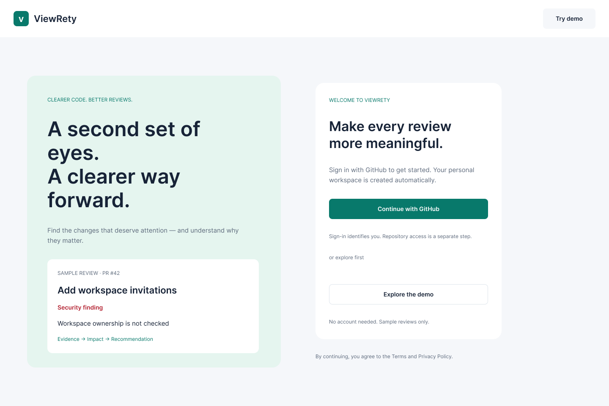
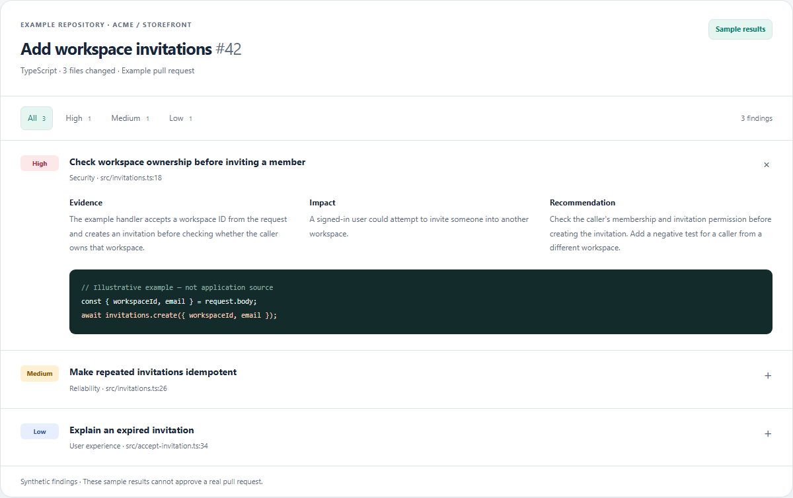
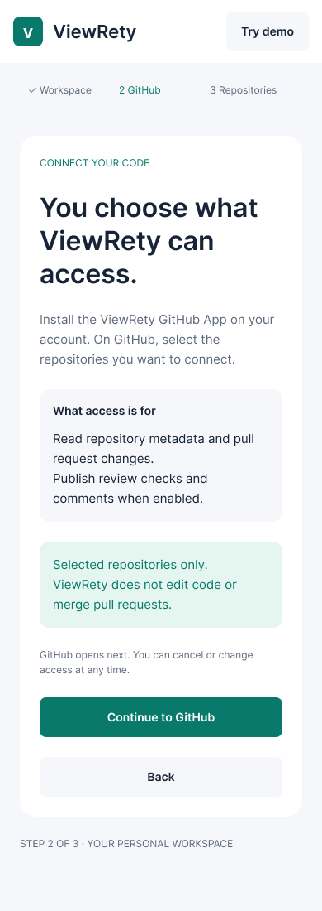
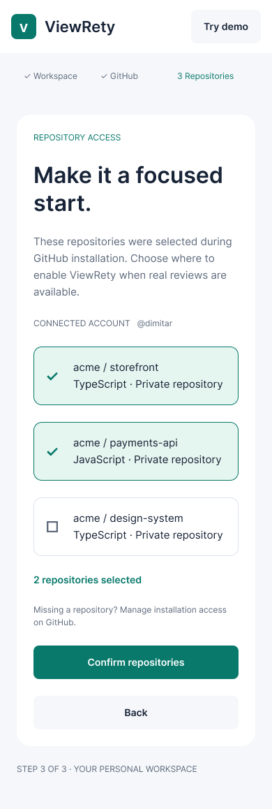

# ViewRety

**A second set of eyes for your pull requests.**

ViewRety is a code review platform in development for individual developers and small teams using GitHub. Its goal is to turn pull request changes into findings that explain the evidence, impact, and recommended fix.

This repository is the **public portfolio showcase**. It includes a small interactive presentation, design previews, architecture notes, and a roadmap. The application source lives in separate private repositories.



## Explore in two minutes

1. Download or clone this repository.
2. Open [`index.html`](index.html) in your browser. No installation or server is needed.
3. Filter the sample findings, expand their evidence, switch theme, and browse the design previews.

The presentation uses fictional, prewritten examples. It does not perform code analysis, connect to GitHub, or represent a completed AI review. There is no hosted public application yet.



## The product journey

**Sign in with GitHub → create a personal workspace → choose repositories → inspect a pull request review.**

The planned review experience prioritizes actionable findings over generic summaries. Each finding should explain what changed, why it matters, where it occurs, and how to address it. Incomplete or failed reviews must remain visibly distinct from successful reviews.

## Current development status

| Area | Available in the private development application | Next |
| --- | --- | --- |
| Product UI | Responsive light/dark interface, GitHub onboarding, repository selection and settings | Dashboard for real review jobs |
| Sample reviews | Read-only demo with 3 repositories, 6 reviews, 8 synthetic findings and severity/category filters | Real pull request findings |
| GitHub integration | Development GitHub App, OAuth, personal workspace and installation access; signed webhook ingestion and duplicate delivery handling | Diff retrieval and review execution |
| Review processing | Pull request snapshots and received review requests | Outbox, queue, worker, retries and deterministic analysis adapter |
| AI and delivery | No paid AI analysis or production deployment | Evaluate a provider, publish GitHub Checks, then run an invited alpha |

The interactive review in **this showcase** is an independent illustration of the intended experience. The images below are Figma design previews; they are not evidence of a live GitHub connection.

## Design previews

| Explain repository access | Select example repositories |
| --- | --- |
|  |  |

Example identities and repository names in the designs are illustrative.

## Engineering approach

| Layer | Technology and purpose |
| --- | --- |
| Frontend | Next.js, React and TypeScript; Figma-led design and responsive UI |
| Backend | Java 25 LTS, Spring Boot and Spring Modulith; explicit module boundaries |
| Persistence | PostgreSQL, Flyway migrations and workspace-scoped data |
| Integration | GitHub App, server-managed sessions, CSRF and signed webhook validation |
| Verification | JUnit, Testcontainers, API contract checks and Playwright browser scenarios |
| Local infrastructure | Docker Compose; cloud infrastructure is a later stage |

This project explores authentication boundaries, event-driven processing, tenant isolation and clear product states alongside the UI. AI-assisted review is the product direction; end-to-end analysis and merge enforcement are still planned.

[Architecture and implemented boundaries](docs/ARCHITECTURE.md) · [Roadmap](docs/ROADMAP.md)

## Repository contents

```text
index.html                 Standalone portfolio presentation
assets/showcase.css        Responsive presentation styles
assets/showcase.js         Sample filters, finding details and theme
assets/*.png               Selected design previews
docs/ARCHITECTURE.md        Current architecture and future pipeline
docs/ROADMAP.md            Development milestones
```

Maintained by [coolHerc02](https://github.com/coolHerc02).
