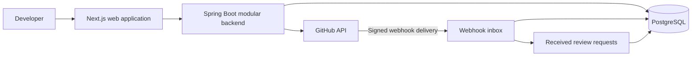
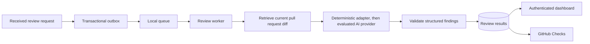

# Architecture

ViewRety is being developed as three private codebases: the web application, a modular backend, and infrastructure configuration. This document is a public overview of the design rather than a deployment guide.

## Current development application



The inbox and review request handling are modules in the backend, not independently deployed services. The local sample review API reads synthetic data from a separate demo database.

### Boundaries that matter

- **Identity and access:** signing in identifies the user; installing the GitHub App grants access to selected repositories. These are separate steps.
- **Workspace ownership:** records belong to a workspace, and the backend checks access. UI visibility is not an authorization boundary.
- **Webhook trust:** signatures are checked against the original request bytes. Delivery identifiers prevent repeated processing of the same delivery.
- **Asynchronous work:** webhook acceptance records an event and a received request. It does not claim that analysis has completed.
- **Schema ownership:** Flyway manages migrations; Hibernate validates the schema.
- **Honest outcomes:** a synthetic result or a failed review must not produce a successful real merge gate.

Automated checks cover module boundaries, PostgreSQL constraints, migrations, access isolation, HTTP contracts and browser journeys. This is a development foundation; production readiness is a future milestone.

## Planned review pipeline



The components in this second diagram are the next implementation stages. Paid AI calls, GitHub Checks and merge enforcement are not active features of the current application.

The intended lifecycle is:

```text
RECEIVED → QUEUED → FETCHING_CONTEXT → ANALYZING
         → VALIDATING → PUBLISHING → COMPLETED
```

Failure, cancellation and superseded changes are separate outcomes. Reviews should track the pull request head SHA so that results for an older change cannot approve a newer one.

## This public repository

The portfolio presentation is plain HTML, CSS and JavaScript. It has no application backend, OAuth flow, API credentials or analysis service. Its findings are fictional and prewritten. The presentation loads local assets and works directly from a downloaded folder.
